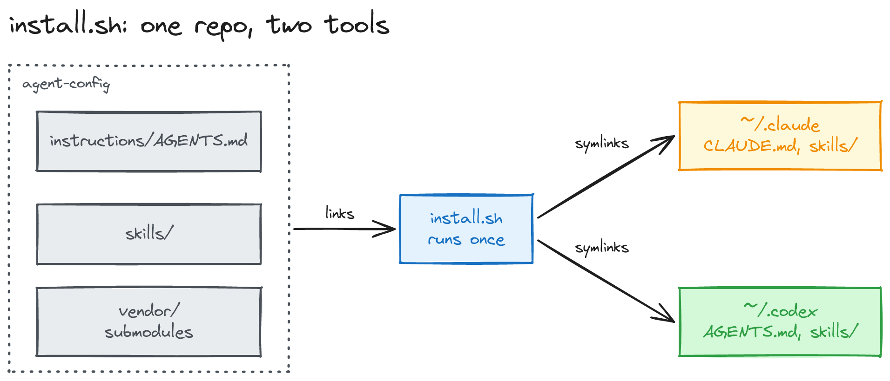
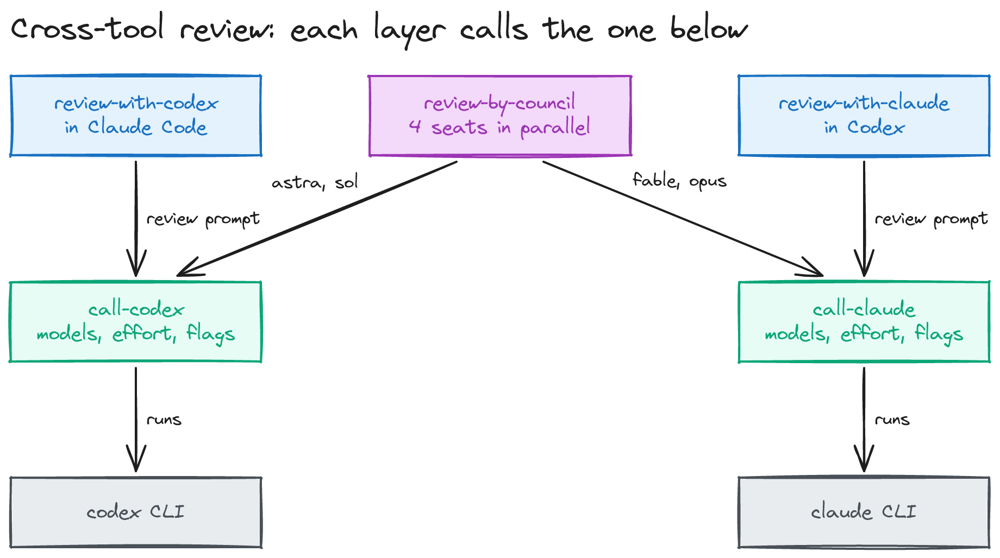
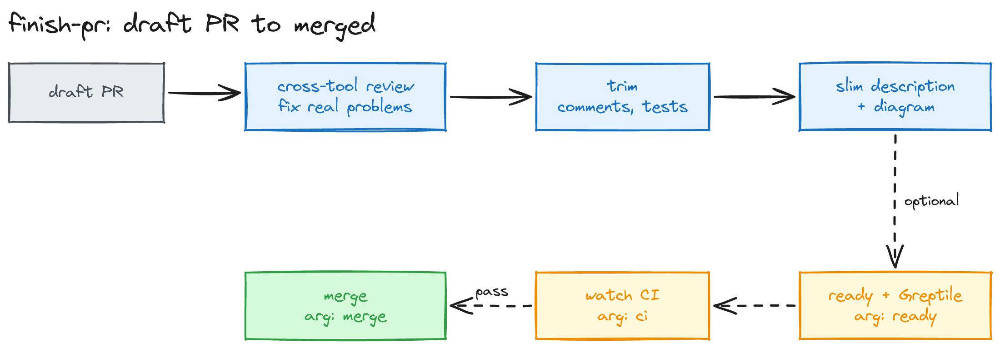

# agent-config

Shared instructions, skills, and hooks for Claude Code and Codex. You edit one repo, and both tools see each change at once.

## Dependencies

This repo pins two skill repos as submodules in `vendor/`:

- [dbanks12/excalidraw-skill](https://github.com/dbanks12/excalidraw-skill): public.
- [dbanks12/claude-authoring-tools](https://github.com/dbanks12/claude-authoring-tools): private. Without access, `install.sh` skips `slide-deck`.

`install.sh` installs no tools. The core set is bash, git, Python 3.11 or later, `jq`, and `gh` with the `gh stack` extension. You also need the `claude` and `codex` CLIs. On macOS, install GNU coreutils for `timeout`.

| Skill | Also needs |
|---|---|
| `excalidraw-skill`, `slide-deck` | Node.js with `npx`. `slide-deck` also needs Pillow and Chrome for PDFs |
| `explainer` | Bun. Narration also needs `ffprobe` and an ElevenLabs key |
| `slack-read` | A Slack user token in `SLACK_TOKEN` |
| `hunk-review`, `hunk-extensions` | `npm i -g hunkdiff@0.22.0` |
| `herdr` | Herdr 0.9.0, run with `HERDR_ENV=1` |

On Ubuntu, Codex needs a Bubblewrap profile. See [Linux setup](linux/README.md). For `/tmp` cleanup, see [Linux cleanup](linux/cleanup/README.md).

## Install



```sh
./install.sh          # link files into ~/.claude and ~/.codex
./install.sh --check  # report drift, change nothing
```

`install.sh` reads `links` and creates one symlink for each line. It backs up replaced files to `~/.local/state/agent-config/backups/`. It also runs `check.sh` and installs it as the pre-commit hook.

Your local `~/.claude/settings.json` and `~/.codex/config.toml` stay outside this repo. To enable the Claude Code hook, add it to `settings.json` with this repo's absolute path:

```json
"hooks": {
  "PreToolUse": [
    { "matcher": "Bash", "hooks": [
      { "type": "command", "command": "bash <repo>/claude-hooks/block-pattern-kills.sh", "timeout": 10 }
    ] }
  ]
}
```

## Skills

| Area | Skills |
|---|---|
| Pull requests | `create-pr`, `finish-pr`, `code-review`, `tdd` |
| Cross-tool review | `call-claude`, `call-codex`, `review-with-claude`, `review-with-codex`, `review-by-council` |
| Thinking and planning | `grilling`, `grill-me`, `grill-me-html`, `to-questionnaire`, `wait-what`, `handoff`, `brief`, `expert-research` |
| Teaching and visuals | `teach-me`, `teach-me-many-topics`, `explainer`, `slide-deck`, `excalidraw-skill` |
| Writing for agents | `writing-for-agents` |
| Tools | `herdr`, `hunk-review`, `hunk-extensions`, `slack-read` |

Each skill is a folder with a `SKILL.md`. Read it for triggers and steps. `instructions/AGENTS.md` is the global instruction file for both tools.

### Cross-tool review

The review skills let one tool ask the other for a second opinion. Each layer calls the one below it. Only `call-claude` and `call-codex` know CLI flags and model names.



`cross-review/` holds the runner scripts and the model list. To add a model name, run `cross-review/update-models.sh add <family> <name> [<cli-model>]`.

### finish-pr

`finish-pr` takes your open draft PR to a reviewable state. It runs a review with the other tool, trims comments and tests, and rewrites the description around one diagram. Arguments add the optional steps: `ready`, `ci`, and `merge`.



## Layout

- `instructions/`: `AGENTS.md`, linked as `~/.claude/CLAUDE.md` and `~/.codex/AGENTS.md`.
- `skills/`: shared skills. A tool-specific skill is named `<purpose>-with-<tool>`.
- `vendor/`: skills from other repos, pinned as submodules. To update one, run `git -C vendor/<name> pull` and commit the new pointer.
- `links`: every managed symlink, as `source target`.
- `claude-hooks/`, `hooks/`: the Claude Code hook and the git pre-commit hook.
- `cross-review/`, `statusline/`, `linux/`: review runners, the Claude status line, and Linux host setup.
- `docs/`: README diagrams, with `.excalidraw` sources.

## License

This repo's own files use the [MIT license](LICENSE). These files come from other projects and keep their own terms:

- `grill-me`, `grilling`, `handoff`, `to-questionnaire`, `wait-what`, `writing-for-agents`, `tdd`, and `code-review` come from [mattpocock/skills](https://github.com/mattpocock/skills). They use the MIT license, with a copy in each folder.
- `hunk-review` and `hunk-extensions` come from the [hunkdiff](https://github.com/modem-dev/hunk) npm package. They use the MIT license, with a copy in each folder.
- `explainer` is adapted from [alejoamiras/aa-skills](https://github.com/alejoamiras/aa-skills/tree/main/skills/explainer). Its author permits this copy, but no open-source license covers it. See [`skills/explainer/NOTICE`](skills/explainer/NOTICE).
- `instructions/AGENTS.md` quotes short passages from Google's writing guides under CC BY 4.0, and from other authors. See [writing sources](instructions/writing-sources.md).
- Each submodule in `vendor/` carries its own license.
